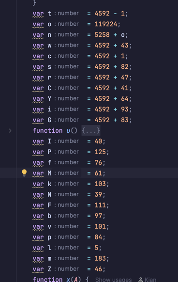
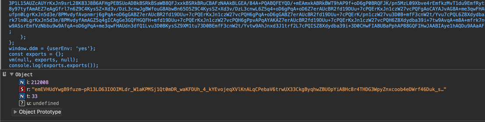
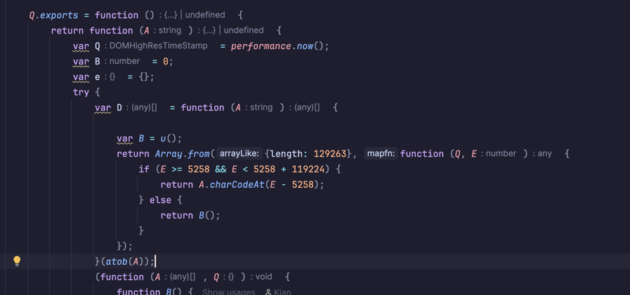
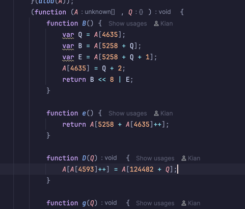
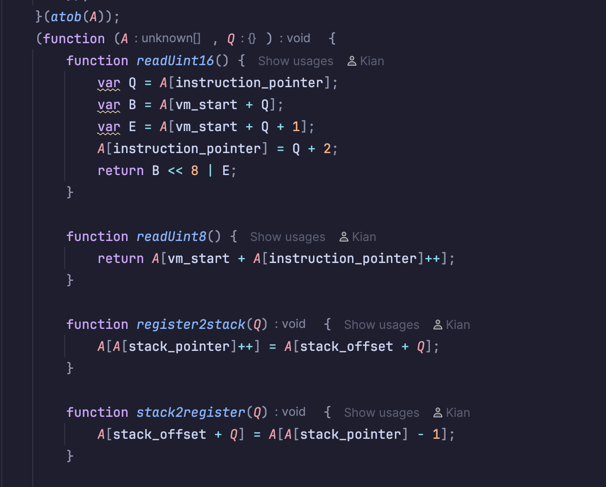
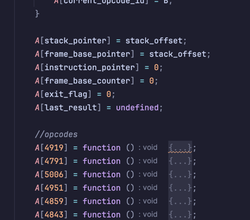
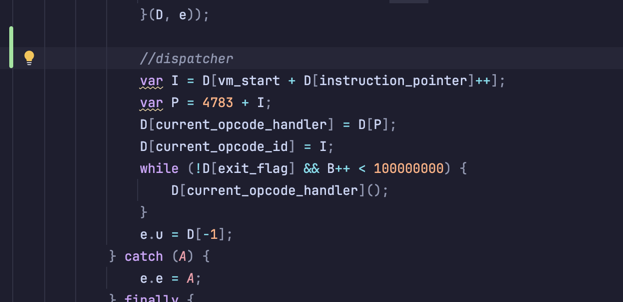
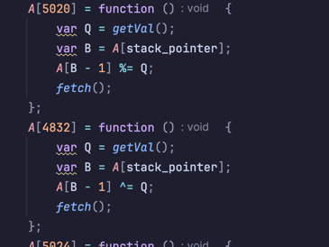

# DataDome VM Analysis

## Summary
This repository documents the first public version of DataDome's in-browser JavaScript virtual machine (VM) used in their CAPTCHA/interstitial flow. This analysis covers:
- Bytecode loading and decoding mechanisms
- VM memory layout and architecture
- A proof-of-concept disassembler
- Control-flow analysis notes

> **Note:** This repository covers only one (static) VM version and is intended for security research and analysis purposes. It does not include dynamic solvers or production solver implementations.

## Background
On January 14, 2026, DataDome began shipping a new VM-based component in their client tag.

## Deobfuscation

The VM code has been extracted from the captcha challenge into `vm.js` (available in this repository).

The first step was deobfuscating the script:



The obfuscation is straightforward: evaluate each variable and replace it with its actual value. A deobfuscation script is available in [deobf.js](deobf.js).

## Initial Analysis

Running the deobfuscated code ([out.js](out.js)) in DevTools reveals the VM's expected output:



The output is a JSON object containing two numbers and a string. Now let's dive into the actual VM implementation.

## Bytecode Decoding



At the start of the `Q.exports` function, we can see how the bytecode is decoded:

1. The input string is base64 decoded
2. An array of length 129,263 is created
3. Each index is checked against a specific range:
   - If the index falls within the range, the value is decoded
   - Otherwise, a random number is returned (using `B()`, a pseudo-random number generator)
-> `D` holds the decoded bytecode with some random "noise"

## VM Architecture



Scrolling down reveals the VM entry point: a function with two parameters `A` (the bytecode) and `Q` (an empty dictionary used for error handling).

### Memory Layout

The most interesting aspect of this VM is its architecture: **everything lives in a single array (`A`)**. This array contains:
- The stack
- Registers
- Opcodes
- The bytecode itself
- The instruction pointer

This design mirrors real computer architecture with distinct memory regions. The next step is to map out each offset to understand what's stored where:
```js
var stack_pointer = 4593
var instruction_pointer = 4635
var frame_base_pointer = 4674
var last_result = 4633
var exit_flag = 4656
var current_opcode_handler = 4685
var current_opcode_id = 4675
var stack_offset = 124482
var vm_start = 5258
```

With these offsets mapped, the VM structure becomes clear.

### Helper Functions



The VM begins with a collection of helper functions that handle:
- Reading typed values from the stack
- Moving data between the stack and "registers"

### VM Initialization



After the helper functions, the VM initializes core values:
- All pointers (stack, instruction, frame base)
- Exit flag
- Last result register

Below the initialization are all the instruction handlers.

### The Dispatcher Loop


The dispatcher is the main VM loop that runs until `exit_flag` is set:

- `I` represents the current instruction
- `P` is the actual offset into the array (accounting for obfuscation)
- The loop sets the current instruction to `current_opcode_handler` and updates `current_opcode_id`

## Opcode Implementation

### How Opcodes Work



Here's a basic example of an opcode handler:

1. Fetches an immediate value from the bytecode
2. Retrieves the top value from the stack
3. Performs an operation (e.g., `%=` or `^=`)
4. Calls the `fetch()` function at the end

### Interesting Opcodes

#### Opcode 4919: Function/Closure Creation

One of the most complex opcodes creates closures/functions:

```js
A[4919] = function () {
    var Q = readUint8();  // Number of expected arguments
    var B = [];
    for (var E = readUint8(), D = 0; D < E; D++) {
        var g = readUint8();
        var a = A[A[frame_base_pointer] + g];
        B.push(a);  // Capture variables from current scope
    }
    var h = A[instruction_pointer] + 3;  // Save address of function body
    A[A[stack_pointer]++] = function (E) {
        // Set up new stack frame when called
        var e = A[stack_pointer] - E;
        while (E < Q) {
            A[e + E++] = undefined;  // Fill missing arguments with undefined
        }
        A[stack_pointer] = e + Q;
        for (var D = 0; D < B.length; D++) {
            var g = B[D];
            A[A[stack_pointer]++] = g;  // Push captured variables
        }
        A[e - 2] = A[frame_base_pointer];  // Save old frame pointer
        A[e - 1] = A[instruction_pointer];  // Save return address
        A[frame_base_pointer] = e;
        A[instruction_pointer] = h;  // Jump to function body
    };
    fetch();
};
```

This opcode:
1. Reads the expected argument count
2. Captures variables from the current scope (closure)
3. Creates a function that sets up a new stack frame with proper calling conventions
4. Handles missing arguments by filling with `undefined`
5. Saves the return address and frame pointer for proper returns

#### Opcode 5003: Dynamic Function Call

This opcode creates a wrapper for function calls that handles both regular and constructor calls:

```js
A[5003] = function () {
    var Q = A[--A[stack_pointer]];  // POP function
    var B = A[--A[stack_pointer]];  // POP 'this' context

    function E(e) {  // e = argument count
        var D = A[stack_pointer];
        var g = A.slice(D - e, D);  // Get arguments from stack
        if (this instanceof E) {
            // Constructor call (new E(...))
            g.unshift(null);
            var h = Function.prototype.bind.apply(Q, g);
            A[stack_pointer] -= e;
            try {
                a = new h();
            } catch (A) {
                a = A.message;
            }
            A[A[stack_pointer]++] = a;
        } else {
            // Regular function call
            var t;
            try {
                t = Q.apply(B, g);
            } catch (A) {
                t = A.message;
            }
            A[stack_pointer] -= e + 2;
            A[A[stack_pointer]++] = t;
        }
    }

    A[A[stack_pointer]++] = E;
    fetch();
};
```

This opcode:
1. Pops the function and context from the stack
2. Creates a wrapper that can be called with arguments
3. Detects whether it's a constructor call (`new`) or regular call
4. Applies the function with proper context and error handling
5. Pushes the result back onto the stack

#### Opcode 4961: Object Literal Construction

```js
A[4961] = function () {
    var Q = {};
    for (var E = readUint16(), e = 0; e < E; e++) {
        var D = A[--A[stack_pointer]];  // First POP
        var g = A[--A[stack_pointer]];  // Second POP
        Q[D] = g;
    }
    A[A[stack_pointer]++] = Q;
    fetch();
};
```

This opcode builds object literals by:
1. Reading the number of property pairs from bytecode
2. Popping pairs from the stack (first pop becomes the key)
3. Constructing an object: `object[firstPop] = secondPop`
4. Pushing the resulting object onto the stack

### The Fetch Function

Each instruction concludes by calling `fetch()`, which prepares the next instruction:

```js
function fetch() {
    var Q = A[instruction_pointer];
    var B = A[vm_start + Q];
    A[instruction_pointer] = Q + 1;
    var E = A[4783 + B];
    A[current_opcode_handler] = E;
    A[current_opcode_id] = B;
}
```

This function:
1. Reads the instruction pointer
2. Fetches the next opcode from bytecode
3. Increments the instruction pointer
4. Looks up the opcode handler
5. Updates `current_opcode_handler` and `current_opcode_id`

This mirrors the dispatcher logic, creating a fetch-decode-execute cycle typical of VM architectures.

## Disassembler Implementation

To aid in analysis, a proof-of-concept disassembler ([disasm.js](disasm.js)) was developed to convert the VM's bytecode into human-readable assembly.

### Approach

The disassembler operates in two passes:

#### Pass 1: Label Discovery

The first pass scans through the bytecode to identify all jump targets. This includes:
- Forward and backward jumps (`JMP_FWD`, `JMP_BACK`)
- Conditional jumps (`JZ`, `JNZ_KEEP`, `JZ_KEEP`)
- Closure boundaries (function bodies and their end points)

Each target address is marked with a label (e.g., `L_0042`) to make control flow easier to follow.

#### Pass 2: Disassembly

The second pass converts each instruction into assembly-like output:

```
000042:  fa 00 0a           PUSH_IMM 10
000045:  19 00 19           PUSH_REG 25
000048:  eb                 ADD
```

Each line includes:
- **Address**: Hexadecimal offset in the bytecode
- **Raw bytes**: The actual bytes making up the instruction (useful for verification) and idk looks tuff asf
- **Opcode**: Mnemonic name of the instruction
- **Arguments**: Decoded operands (register numbers, immediates, jump targets)

### Value Decoding

One of the more complex aspects is decoding immediate values embedded in the bytecode. The VM uses type markers to indicate how to interpret the following bytes:

**Simple types** (no additional data):
- `0x28` → `true`
- `0x7D` → `false`
- `0x4C` → `null`
- `0x3D` → `undefined`

**Small integers** (0-127): Encoded with high bit set
- `0x85` → `5` (0x80 | 5)

**Strings**: XOR-encoded and null-terminated
- ASCII strings: marker `0x67`, XOR key starts at 183
- UTF-8 strings: marker `0x27`, XOR key starts at 46

**Numeric types**:
- 8-bit signed: `0x6F` + 1 byte
- 16-bit signed: `0x61` + 2 bytes (big-endian)
- 24-bit signed: `0x65` + 3 bytes (big-endian)
- 32-bit signed: `0x54` + 4 bytes (big-endian)
- IEEE 754 double: `0x05` + 8 bytes

The XOR encoding for strings is straightforward but prevents casual inspection:

```js
let str = '';
let xorKey = 183;  // Initial key for ASCII strings
let ch;
while ((ch = readByte() ^ (xorKey++ & 0xFF)) !== 0) {
    str += String.fromCharCode(ch);
}
```

### Special Opcodes

Some opcodes require custom handling:

**CLOSURE (opcode 136)**: Creates functions/closures with captured variables
```
Format: CLOSURE locals, capture_count, [capture_indices...], skip_offset
```
The skip offset points past the function body, allowing the VM to skip over the function definition during linear execution.

**PUSH_MULTI_IMM (opcode 96)**: Pushes multiple values at once
```
Format: PUSH_MULTI_IMM count, val1, val2, ...
```

### Usage

```bash
# Disassemble from file
node disasm.js bytecode.txt

```

### Example Output

```
; DataDome VM Disassembly
; Bytecode size: 5428 bytes
; VM Constants: VM_START=5258, OPCODE_BASE=4783

000000:  88 01 00 04        CLOSURE locals=1, captures=[0, 4], body=L_0006, end=L_0a3f
L_0006:
000006:  fa 67 ...          PUSH_IMM "window"
00001f:  2b                 PUSH_WINDOW
000020:  02                 SET
000021:  fa 67 ...          PUSH_IMM "navigator"
00003a:  19 00 00           PUSH_REG 0
00003d:  fa 67 ...          PUSH_IMM "navigator"
000056:  ee                 GET
000057:  02                 SET
...
```

This output format makes it possible to:
- Trace execution flow by following jump labels
- Identify function boundaries via CLOSURE opcodes
- See exactly what values are being pushed and manipulated
- Cross-reference with the actual VM implementation

---

## Notes

I'm still pretty new to VMs so take everything with a grain of salt. AI has been used to help document the code and write parts of this readme (because writing docs is painful).

## Disclaimer

This is purely for educational/security research purposes. No solvers or bypasses included - just documenting how the VM works because it's genuinely interesting.

**DataDome**: if you're reading this, hello!!! This is just me trying to get a scholarship 🙏. Please don't sue me, I'm broke asf. If you have any issues with this repo just let me know and we can talk about it :)


sorry for the people that thought I'm going to talk about the inside of the vm... that's not happening

DO NOT DM ME AND ASK FOR A DATADOME API, I WILL NOT HELP YOU